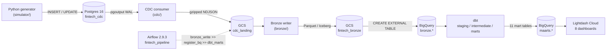

# fintech-payments

A synthetic-data pipeline for a South African SME payments and lending business, built end to end: from a stateful event generator writing to Postgres, through a custom CDC consumer landing changes in GCS, into Apache Iceberg Bronze tables, up through BigQuery and dbt mart models, and out to Lightdash dashboards. Airflow orchestrates the full write-transform-serve cycle on a schedule.

---

## The problem

A payment company generates data you cannot study without working there. Card authorisations, EFT collections, loan repayments, risk events: each stream depends on the others in ways that matter to any engineer modelling them. Realistic test data for this domain does not exist on Kaggle. I had to build it.

The pipeline produces causally coherent synthetic events for a simplified SA merchant payments business. Settlement follows the right channels. Repayments follow a DebiCheck schedule. Risk events fire when GPV patterns cross the thresholds that cause them. The domain knowledge required to make the data behave honestly was most of the work, and it was not what I expected.

This is a simplified version of what takes whole engineering teams to build. Close enough to understand why each layer matters.

---

## What it does

- **Generates** stateful merchant and transaction history. Merchants activate, grow, stress, churn. Loans disburse and collect. Risk events fire from real causal rules. The largest run onboarded 1,185 merchants and produced 8.5 million events over 15 simulated months.
- **Captures** every change from Postgres WAL via a custom `pgoutput` consumer, landing gzipped NDJSON to Google Cloud Storage without touching the source database.
- **Writes** those events into Apache Iceberg Bronze tables on GCS, one Parquet file set per table and partition, with a full crash-recovery and idempotency proof.
- **Transforms** through dbt: five staging views, eight intermediate models and eleven mart fact tables in BigQuery, rebuilt on each pipeline run.
- **Visualises** in Lightdash Cloud: eight dashboards covering GPV, settlement, lending portfolio quality, revenue, merchant health, and risk.

---

## Architecture



Five streams flow left to right. The CDC consumer and Bronze writer are separate processes; Airflow joins them on a daily schedule. The generator runs independently to load new data.

---

## Key results

| Metric | Figure |
|---|---|
| Largest simulation run | 1,185 merchants onboarded, 8,537,090 rows |
| Bronze write (1,000-merchant run) | 8.5M events across 5 Iceberg tables |
| BigQuery re-registration | 23 sec |
| dbt marts rebuild (11 tables) | 65 sec |
| fct_payments_daily | 161,500 rows |
| fct_settlement_daily | 396,100 rows |
| Total transactions | 8,321,600 |
| Completed payments | 7,657,428 |
| Gross GPV | R1,051,946,625 (just over R1 billion) |
| Test suite | 3,853 tests, 0 skips |

Row counts and totals verified on the 1,000-merchant run, session 38 (2026-11-07).

---

## What building it taught me

The generator was not the hard part. The domain was.

I had to find out when SASSA grants actually pay out, how DebiCheck collection mechanics work, what a PAR curve looks like when the underlying data is seasonally coherent, and why January transaction counts rise while basket sizes fall. Each wrong version of the simulator failed loudly. That was how I learned the domain was what the data required, not just the pipeline.

One thing I got wrong first: the EFT funnel completion band in the design documents could not be reached with the sourced parameters. I had to amend the validation target and document why. The band is now what the parameters actually produce, with a note in the config. Calling it a failure is accurate. Calling it only a failure misses what it taught.

The arc from getting a pipeline to run to caring about what the numbers represent took about a year. I am still figuring out what that fully means.

---

## Stack

**Main**

| Tool | Role |
|---|---|
| BigQuery | Data warehouse. Hosts external Iceberg tables and dbt mart output. |
| Apache Airflow 2.9.3 | Orchestrates the pipeline on a daily schedule (LocalExecutor, Docker Compose). |
| dbt (dbt-bigquery 1.9.2) | Transforms Bronze sources into 11 mart fact tables via staging and intermediate layers. |
| Python 3.13 | Generator, CDC consumer, Bronze writer, all scripts. |
| Google Cloud Platform | Cloud host (project `payments-512910`, `us-east1`). |

**Supporting**

| Tool | Role |
|---|---|
| Postgres 16 | OLTP source with `wal_level=logical` for CDC. |
| Apache Iceberg (PyIceberg 0.12.0) | Bronze table format on GCS. |
| Google Cloud Storage | CDC landing bucket and Bronze storage. |
| Lightdash Cloud | BI layer: 8 dashboards, 32 charts. |
| psycopg3 | Postgres client for the generator and CDC consumer. |
| Pydantic v2 | Schema validation for all five event streams. |
| PyArrow 26.0.0 | In-memory columnar format during Iceberg writes. |
| SQLAlchemy + SQLite | Local Iceberg catalog backend. |
| dbt-utils | Date spine and surrogate key macros. |
| Terraform 1.17.1 | Infrastructure as code for GCP resources (IAM, buckets, service accounts). |
| Docker + Docker Compose | Container runtime for Postgres and the Airflow stack. |
| pytest | 3,853 tests across the full stack. |
| GitHub Actions | CI: pytest, dbt deps check, terraform validate. |
| Gzipped NDJSON | CDC event landing format: one object per table per event date. |
| Apache Parquet | Bronze data files inside the Iceberg tables. |
| YAML | Simulation config (5 config files, 11 archetypes, causal rules). |
| CSV seeds | SA public holidays and lending provision rates in dbt. |

---

## Quick start

```bash
docker compose up -d
python -m venv .venv && source .venv/bin/activate
pip install -r requirements.txt -r requirements-dev.txt
cp .env.example .env
docker exec -i fintech_pg psql -U sim -d fintech < migrations/001_initial_schema.sql
docker exec -i fintech_pg psql -U sim -d fintech < migrations/002_loan_repayments_fk.sql
docker exec -i fintech_pg psql -U sim -d fintech < migrations/003_loan_applications_replica_identity.sql
pytest tests/ -q -m "not slow"
python -m simulator.main --mode backfill --start-date 2025-01-01 --end-date 2026-01-01 --merchant-count 100
```

The full operational runbook, including CDC setup, Bronze write, BigQuery registration, dbt and Lightdash, is in [docs/runbook.md](docs/runbook.md).

---

## Deep dives

- [Architecture](docs/architecture.md): components and data flow
- [Data model](docs/data-model.md): schemas, layers, key tables, lineage
- [Orchestration](docs/orchestration.md): DAG design, scheduling, failure handling
- [Cost and performance](docs/cost-and-performance.md): GCS operations, timing, optimisations
- [Design decisions](docs/design-decisions.md): trade-offs and what went wrong first

---

The pipeline ran end to end on 1,000-merchant data in November 2026. What I still want to understand better is how the mart layer holds up at ten times the size with real query concurrency. That is the next question.
